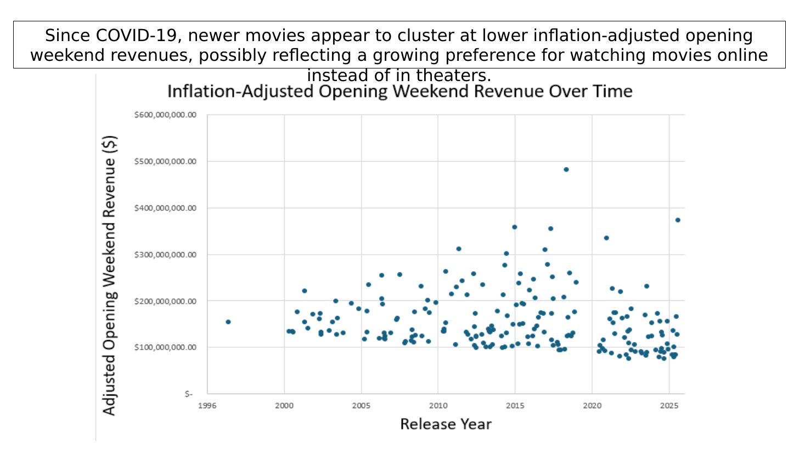
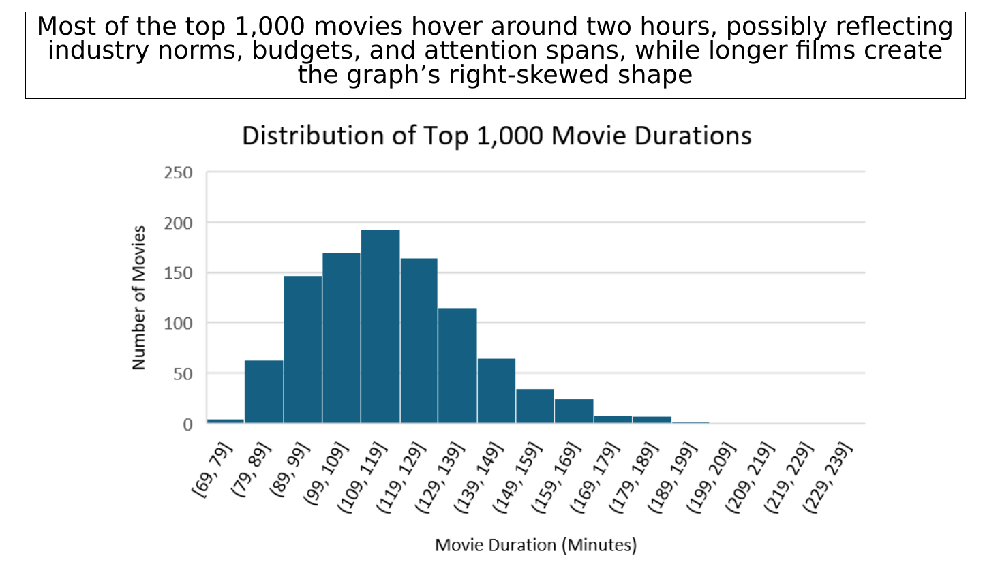
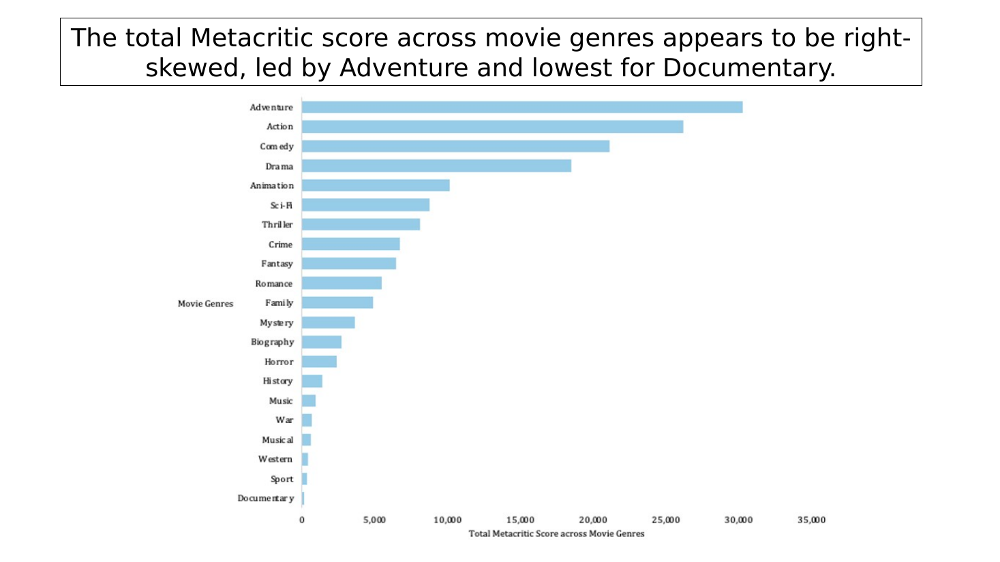
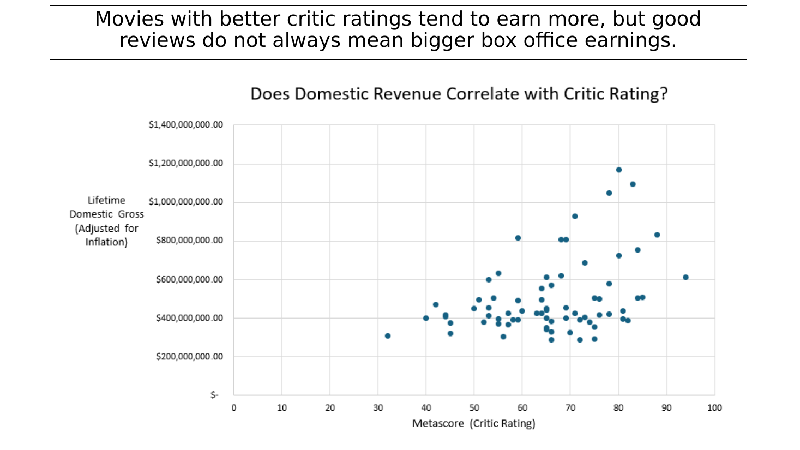

## Team

This was a team project for INEG 21003 (Intro to Industrial Engineering). Group members and their e-Portfolios:

- **Ladd Choate** — [laddchoate.github.io](https://laddchoate.github.io)
- **Henry Oglesby** — [henry-oglesby.github.io](https://henry-oglesby.github.io/posts/Data%20Visualization/)
- **Matthew Chafin** — [matthewchafin.github.io](https://matthewchafin.github.io/Matthew-Chafin-Intro-Into-IE-E-Portfolio/index.html)
- **Holt Zeidler**
- **Noah Simson**

## The Data Set

Our data set is a collection of the top 1,000 movies, with one row per film. For each movie it lists the release date, domestic opening weekend revenue, total domestic box office earnings, runtime in minutes, genre(s), and Metacritic critic score. Because the movies span more than 25 years of releases, we adjusted the revenue figures for inflation so that older and newer films could be compared fairly. All of the analysis and charts were built in Excel ([link to our shared workbook](https://1drv.ms/x/c/b59da3434b65becf/IQDyi6TXJJA7TYCCjKxlZu6AASzSSMHh9iv7UP3Ye6UDl2w?e=EM7iyQ)).

Each question below is answered with an **assertion-evidence slide**: the headline states the takeaway as a full sentence, and the chart underneath is the evidence for it.

---

## Question 1: Have opening weekends changed since COVID-19?

**The question.** How does a movie's inflation-adjusted opening weekend revenue change with its release date, and do movies released after COVID-19 look different from those released before it?

**Why it's interesting.** Theaters closed in 2020 and streaming services grew quickly. Opening weekend is the clearest measure of how many people rush to see a movie in theaters, so it's a good place to look for a shift in viewing habits.

**How we used Excel.** We converted each opening weekend total to today's dollars with an inflation-adjustment column, then plotted adjusted revenue against release date in a scatter plot, one dot per movie. We formatted the vertical axis as currency so the outliers are easy to read.

{fig-alt="Assertion-evidence slide: scatter plot of inflation-adjusted opening weekend revenue by release year"}

**How the slide was developed.** We started with the scatter plot and looked for a pattern before writing the headline. Two things stood out: a gap around 2020 when theaters were closed, and a tight cluster of post-2020 releases near the bottom of the chart. The headline says "appear to" and "possibly" on purpose, because opening weekend revenue alone can't prove why earnings dropped. Standouts include *Avengers: Endgame* (the highest opening in the data set) and the low openings of several recent releases.

---

## Question 2: How long are most movies?

**The question.** How are runtimes distributed across the top 1,000 movies?

**Why it's interesting.** Runtime affects how many showings a theater can fit in a day, how much a movie costs to make, and whether audiences stay engaged. It's useful to know whether there is a "standard" length.

**How we used Excel.** We grouped the runtimes into 10-minute bins and built a histogram of how many movies fall in each bin.

{fig-alt="Assertion-evidence slide: histogram of movie runtimes showing a peak near two hours and a right-skewed tail"}

**How the slide was developed.** The histogram showed a clear peak around 110–119 minutes, with most movies between about 90 and 140 minutes, and a long tail of much longer films. That tail makes the distribution right-skewed, so we put the shape of the distribution in the headline along with the "about two hours" norm.

---

## Question 3: Which genres dominate the critic scores?

**The question.** What is the total Metacritic score for each movie genre?

**Why it's interesting.** It shows which genres make up most of the critically reviewed movies in the data set, and how unevenly they are spread.

**How we used Excel.** Many movies have more than one genre, so we totaled the Metacritic scores for each genre with a conditional sum: a movie's score counts toward every genre it's tagged with. We then sorted the totals from highest to lowest and displayed them as a horizontal bar chart.

{fig-alt="Assertion-evidence slide: horizontal bar chart of total Metacritic score by genre, led by Adventure"}

**How the slide was developed.** Sorting the bars made the pattern obvious: Adventure (about 30,000), Action, Comedy, and Drama dominate, then the totals fall off quickly down to Documentary. A total depends heavily on how many movies a genre has, so this chart shows which genres show up most among reviewed movies more than which ones critics rate highest.

---

## Question 4: Do better reviews mean bigger earnings?

**The question.** Is there a relationship between a movie's critic rating and its inflation-adjusted total domestic earnings?

**Why it's interesting.** Studios, investors, and moviegoers all want to know whether good reviews actually translate into ticket sales.

**How we used Excel.** We plotted Metacritic score against inflation-adjusted total domestic earnings in a scatter plot, one dot per movie.

{fig-alt="Assertion-evidence slide: scatter plot of critic rating versus inflation-adjusted domestic earnings"}

**How the slide was developed.** The chart shows a loose upward trend with plenty of exceptions, so the headline makes both points. One example we used: *Star Wars: The Force Awakens* earned more than twice as much as *Harry Potter and the Goblet of Fire* even though its critic score was much lower (59 vs. 82). Advertising, release timing, and loyal fan bases matter as much as reviews.

---

## Connecting the Graphs

Taken together, the four charts show that there's no single formula for a successful movie. Newer movies tend to have smaller opening weekends, most films stay close to two hours, a few genres dominate the market, and good reviews help but don't guarantee big earnings.
